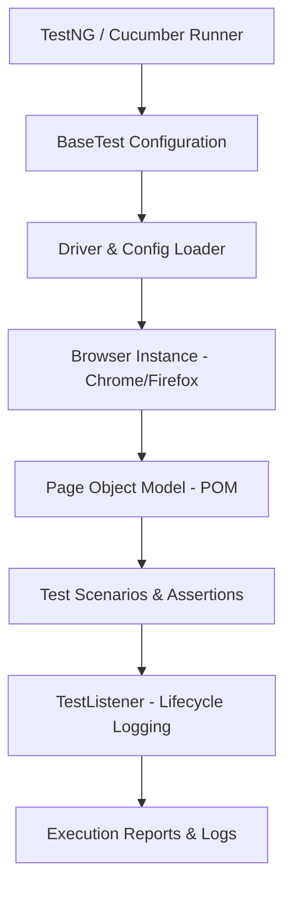

# Enterprise Web Automation Framework (Java & Selenium)

A modular, scalable test automation framework built in **Java** and **Selenium WebDriver** for end-to-end regression, smoke, and functional testing on web applications.

Architected using the **Page Object Model (POM)** and **BDD (Cucumber / Gherkin)** to ensure high maintainability, clean test separation, and resilience against flaky DOM elements.

---

## 🛠 Tech Stack & Tools
- **Language:** Java 17+
- **Core Automation:** Selenium WebDriver 4
- **Test Frameworks:** TestNG, Cucumber (BDD)
- **Build Tool:** Gradle
- **Design Pattern:** Page Object Model (POM) & Data-Driven Testing
- **Reporting & Logging:** TestNG XML Reports, Log4j

---

## 🏗 Architecture & Structure
```text
src/
├── test/
│   ├── java/
│   │   ├── pages/             # Encapsulated Page Objects & UI locators
│   │   ├── tests/             # TestNG test scripts (Smoke, Regression, E2E)
│   │   ├── apiTests/          # API integration tests & backend validation
│   │   └── base/              # BaseTest setup, browser drivers, teardown
│   └── resources/
│       ├── features/          # Cucumber Gherkin (.feature) specifications
│       └── TestNG.xml         # Test suite orchestration & parallel execution


